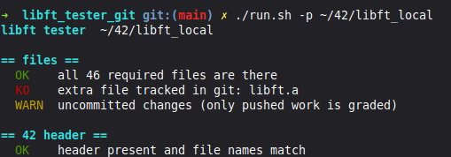
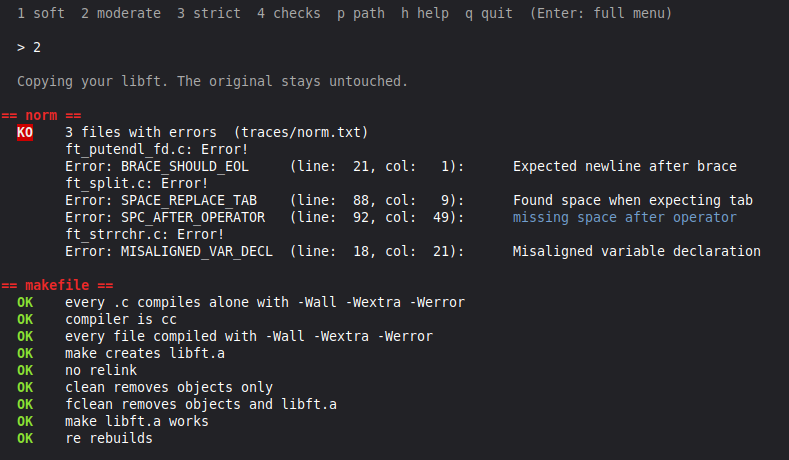

# WankaLIB

LIBFT Tester

A tester for the 42 libft, subject version 19.3 (Nov2026, the three parts are mandatory, there is no bonus)

It checks the functions and also everything around them: files, 42 headers, norm, Makefile, prototypes, forbidden functions and the README

One command, `./run.sh`, opens a menu that stays open: three levels (`soft` `moderate` `strict`), any mix of checks and functions, and a score out of 100 after every run

Every test has a number (`1)OK 2)OK 3)KO`) and every KO leaves a trace that says why that test exists, the line of code that failed, what you got and what was expected

Want to find the bug alone? Leave it like that. Want the tester to point at it? Turn on `where` (`w` in the menu) and crashes and leaks show the line of your code that caused them

The tester tells you when there is a new version and updates itself with `u` in the menu or `./run.sh update`

Your libft is never modified. The tester copies it to a hidden folder and builds it there

_42Malaga_

> Versión en español al final: [Español](#español)

## Preview

```
  __      __             _          _     ___  ___
  \ \    / / __ _  _ _  | |__ __ _ | |   |_ _|| _ )
   \ \/\/ / / _` || ' \ | / // _` || |__  | | | _ \
    \_/\_/  \__,_||_||_||_\_\\__,_||____||___||___/
  libft tester  42 Malaga, subject 19.3

== menu ==
  libft     ~/42/libft
  valgrind  on
  where     off (only OK or KO, you find the bug in your code)
  version   up to date (newest version)

  1  soft      function tests without valgrind (fast)
  2  moderate  norm, Makefile and function tests with valgrind
  3  strict    everything, warnings count as KO
  4  checks    every check, no function tests
  p  path      change the libft folder
  v  valgrind  turn it on or off
  w  where     show the line of your code that crashes or leaks
  h  help      every target and option explained
  c  clean     q  quit
  or type any targets, like: norm split atoi
  your libft is copied again on every run:
  edit it in another tab, come back and run again

  >
```






## Install

```bash
git clone https://github.com/fe4d1/WankaLIB.git
cd WankaLIB
```

Requirements: Linux, `cc`, `make`

`norminette` and `valgrind` are optional. If they are installed the tester uses them

## Update

```bash
./run.sh update
```

or `u` in the menu. It downloads the last version (`git pull`), shows what changed and, in the menu, opens the new version right away

- every time the tester starts it looks at GitHub in the background, it changes nothing, it only compares commits
- the `version` line at the top of the menu shows the result

| `version` says | Meaning |
|---|---|
| `up to date (newest version)` | you have the last version |
| `new version available, press u to update` | there is a new version, `u` also appears in the menu |
| `checking...` | GitHub has not answered yet, press Enter to see the menu again |
| `could not check (no internet?)` | GitHub could not be reached |
| `update check off` | `UPDATE_CHECK=0` in `config.sh` |
| `not a git clone, cannot update` | the tester was downloaded as a zip |
- if you changed tracked files of the tester (like `LIBFT` in `config.sh`) they are kept: git stashes them, updates and puts them back
- `UPDATE_CHECK=0` in `config.sh` turns the check off. `./run.sh update` still works
- it needs a clone made with git. A zip download cannot update

**Cloned before the update command existed?** Your `run.sh` does not know `update` yet. Run this once, from then on `u` and `./run.sh update` work

```bash
cd WankaLIB
git pull
```

## Quick start

```bash
./run.sh
```

That is the only command you need. It opens the menu and it stays open until you press `q`

1. Look at the `libft` line at the top of the menu. If it is not your libft, press `p` and type the folder. It is remembered for the next time
2. Press `1`, `2`, `3` or `4` and Enter, or type what you want to run, like `norm split atoi`
3. Read the result. The menu is still there

To fix something, leave the tester open, change your code in another tab or in your editor, come back and run again. Your libft is copied again on every run, so there is nothing to restart

### Where the tester looks for your libft

The first one that exists

| Order | Folder |
|---|---|
| 1 | `-p path` on the command line |
| 2 | the folder you chose with `p` in the menu (saved in `.libft_path`) |
| 3 | `LIBFT` in `config.sh`, by default `../libft` |
| 4 | the folder that contains the tester, when it has a `libft.h` |
| 5 | the folder you are in, when it has a `libft.h` |

So if you clone the tester inside your libft, next to your `.c` files, it finds it alone. In that case its folder is not reported as an extra file, but do not add it to your repo

### Without the menu

Put what you want after the command. It runs once and exits

```bash
./run.sh soft
./run.sh -p ../libft norm split atoi
```

## Usage

```
./run.sh [options] [targets]
```

Options go first. With no target you get the menu. With targets it runs them once and exits. When there is no target and the output is not a terminal (a pipe, a script) everything is checked

### Menu

It opens when there is no target, or with the target `menu`. It stays open: after every run, and after the help, you are back at the prompt

| Key | Does |
|---|---|
| `1` | level `soft` |
| `2` | level `moderate` |
| `3` | level `strict` |
| `4` | every check, no function tests |
| `p` | changes the libft folder and remembers it. Tab completes the path |
| `v` | turns valgrind on or off for the next runs |
| `w` | turns `where` on or off: crashes and leaks show the line of your code, see [Where](#where-the-line-of-your-code) |
| `u` | updates the tester. The menu shows it when there is a new version, see [Update](#update) |
| `h` | the help: every target and option. You stay in the menu |
| `c` | deletes the build files and the traces |
| `q` | quits |
| Enter | shows the full menu again |
| anything else | it is read as a list of targets, like `norm split atoi` |

The up arrow brings back what you typed before

### Levels

| Level | Runs | Use it |
|---|---|---|
| `soft` | the 43 function tests without valgrind. Leaks are not checked | while you code, it takes a few seconds |
| `moderate` | `norm`, `make` and the 43 function tests with valgrind | when a function looks finished |
| `strict` | everything, and every `WARN` becomes a `KO` | before you push |

The levels are also targets, so they work from the command line and can be mixed with the rest: `./run.sh -p ../libft soft norm`

### Examples

| Command | What it does |
|---|---|
| `./run.sh` | the menu, it stays open |
| `./run.sh -p ../libft` | the menu, with that libft |
| `./run.sh -p ../libft all` | everything |
| `./run.sh -p ../libft soft` | a level (`soft` `moderate` `strict`) |
| `./run.sh -p ../libft soft norm readme` | mixed: a level and two checks |
| `./run.sh -p ../libft norm` | one check |
| `./run.sh -p ../libft header make readme` | several checks |
| `./run.sh -p ../libft ft_split` | one function (`split` works too) |
| `./run.sh -p ../libft atoi itoa split` | several functions |
| `./run.sh -p ../libft part3` | one part (`part1` `part2` `part3`) |
| `./run.sh -p ../libft checks` | every check, no function tests |
| `./run.sh -p ../libft funcs` | every function test, no checks |
| `./run.sh -p ../libft norm ft_split` | mixed: a check and a function |
| `./run.sh -n -p ../libft funcs` | every function, fast (no valgrind) |
| `./run.sh -w -p ../libft split` | one function, and the line of your code if it crashes or leaks |
| `./run.sh -u jdoe -p ../libft header` | headers must belong to login `jdoe` |
| `./run.sh -h` | help |
| `./run.sh update` | download the last version of the tester |
| `./run.sh clean` | delete the build files and the traces |
| `./run.sh reset` | put the tester back as in its last commit |

### Options

| Option | Meaning |
|---|---|
| `-p path` | where the libft is. Without it, see [Where the tester looks for your libft](#where-the-tester-looks-for-your-libft) |
| `-n` | no valgrind: faster, but leaks are not checked |
| `-w` | `where` on: crashes and leaks show the line of your code. See [Where](#where-the-line-of-your-code) |
| `-u login` | the login every 42 header must have. Without it the tester only checks that all files have the same author |
| `-h` | help |

To stop typing `-p`, press `p` in the menu once, or set `LIBFT` in `config.sh`

### Targets

| Target | Runs |
|---|---|
| none or `menu` | the menu |
| `all` | everything |
| `soft` `moderate` `strict` | a level, see [Levels](#levels) |
| `checks` | `files header norm make protos symbols readme` |
| `files` `header` `norm` `make` `protos` `symbols` `readme` | that check only |
| `funcs` | the 43 function tests |
| `part1` `part2` `part3` | the function tests of that part |
| `ft_name` or `name` | that function only |

The exit code is 0 when there is no KO. It is 1 when there is a KO or when nothing was run (an unknown target)

### Clean and reset

| Command | Does |
|---|---|
| `./run.sh clean` | deletes `.build/` `.bin/` and `traces/`. Like `make fclean` |
| `./run.sh reset` | throws away every change made to the tester since the last commit, also new files. It lists the changes and asks you to type `yes` first |

`clean` does not forget the libft folder. You rarely need it: every run deletes the old traces, and `traces/` disappears when everything passes. None of these folders are tracked by git

`reset` goes back to the last commit, not to the GitHub version. To get the GitHub version use `./run.sh update`. To throw away your changes and get exactly the GitHub version run `git fetch && git reset --hard origin/main`

## Checks

| Target | What it looks at |
|---|---|
| `files` | the 43 `.c` files, `Makefile`, `libft.h` and `README.md` exist. Required files that are not in git (not added). Extra files tracked in git. Uncommitted changes and commits not pushed |
| `header` | 42 header in every file: 80 columns, right file name, login and mail, same author in all files. The campus in the mail is not checked, so it works for any campus |
| `norm` | norminette on every `.c` and `.h` |
| `make` | rules `$(NAME)` `all` `clean` `fclean` `re` exist and work. `NAME` is `libft.a` and it is created at the root. Compiler is `cc`. The three flags on every file, and every `.c` compiles alone with them. Built with `ar`, no `libtool`. No wildcard. No `-std=c99`. No relink |
| `protos` | include guard, `t_list` has exactly `content` and `next`, every prototype compared with the subject. No `restrict` |
| `symbols` | external functions used by each file against what the subject allows for that function. Global variables, also the `static` and `const` ones. Helpers that are not static. A `main` left inside the library |
| `readme` | first line, the Description Instructions and Resources sections, AI usage, every function mentioned (the detailed description of the library) |

What the subject asks and where it is checked

| Subject | Target |
|---|---|
| Norm | `norm` `header` |
| No crash, no leak | function tests |
| `cc` with `-Wall -Wextra -Werror`, no relink, the five rules | `make` |
| Files to submit, files at the root, no unused files | `files` |
| No global variables, static helpers | `symbols` |
| `ar` and not `libtool`, `libft.a` at the root | `make` |
| Same prototypes as the originals, no `restrict`, no `-std=c99` | `protos` `make` |
| No external functions in part 1, only the listed ones in parts 2 and 3 | `symbols` |
| `is*` functions return exactly 1 or 0 | function tests |
| `calloc` with 0 returns a unique pointer that can be freed | function tests |
| `NULL` when an allocation fails | function tests |
| `t_list` structure | `protos` |
| README requirements | `readme` |

Two things cannot be checked by a script: that the README resources are real references, and that you can explain your code

## Function tests

Your libft does not need to be finished. Before the tests the tester looks at what your libft really has: the functions inside `libft.a`, the prototypes in `libft.h`, `t_list` and which functions call a missing one. What cannot be tested is marked `MISSING` with the reason and everything else is tested normally. So a libft without the list functions yet still gets its other 34 functions tested

If there is no Makefile, or `make` fails (one `.c` with an error is enough), that is a `KO`, and then the tester compiles every `.c` alone and builds its own `libft.a` with what compiles, so the rest is still tested. You see `WARN tested with a libft.a built by the tester`

```
== functions ==
  9 of 43 not found in your libft, marked MISSING:
  lstnew lstadd_front lstsize lstlast lstadd_back lstdelone lstclear
  lstiter lstmap
  the rest is tested normally

  ft_isalpha      1)OK 2)OK 3)OK 4)OK 5)OK 6)OK 7)OK
  ...
  ft_lstnew       MISSING  t_list is not defined in libft.h
```

| Reason | What to do |
|---|---|
| `there is no libft.h` | nothing can be tested without it |
| `t_list is not defined in libft.h` | add the `t_list` structure of the subject to `libft.h` |
| `ft_name.c does not compile` | the error is in `traces/build.txt` |
| `not written yet (no ft_name.c)` | write it |
| `not in libft.a (ft_name.c is empty or not in the Makefile)` | finish it, or add its `.c` to the Makefile |
| `ft_name.c has no ft_name in it` | the file compiles but the function is not there (no Makefile case) |
| `it uses ft_other, which is missing` | it calls a function that is missing, fix that one first |
| `no prototype of ft_name in libft.h` | add the prototype to `libft.h` |

One file per function in `tests/`. Each one checks

- normal results and edge cases
- crashes and infinite loops
- leaks and invalid reads with valgrind
- every `malloc` failing in turn, to see that the function returns `NULL` and frees what it had

Every test has a `//` comment above it that says why it is there and what mistake it catches. Open `tests/ft_name.c` to read them all, or just read the trace: the comment of the test that failed is copied there

## Output

```
== makefile ==
  OK    compiler is cc
  KO    relink (second make does something)

== functions ==
  ft_strlen       1)OK 2)OK 3)OK 4)OK 5)OK 6)OK  MEM OK
  ft_itoa         1)OK 2)OK 3)OK 4)OK 5)OK 6)OK 7)OK 8)OK 9)OK 10)OK 11)KO
                  12)OK 13)OK  MEM OK  (traces/ft_itoa.txt)
  ft_lstlast      1)CRASH  MEM KO  (traces/ft_lstlast.txt)
```

The number is the test number inside that function. It is the same number you see in the trace (`KO test 11`) and in the result (`ft_itoa: test 11`). When a line is wider than the terminal it goes on below

| Word | Meaning |
|---|---|
| `OK` | the check or test passed. Green |
| `KO` | it failed. See the file in `traces/`. White on red |
| `WARN` | not a fail, but look at it. With `strict` it is a `KO` |
| `MEM OK` | valgrind found no leaks and no invalid reads or writes in that function |
| `MEM KO` | valgrind found a problem. The details are in the trace file |
| `CRASH` | the function crashed (segfault, bus error, abort). The tests after it did not run |
| `TIMEOUT` | the test never finished, usually an infinite loop |
| `MISSING` | the function is not in your libft yet, so it is not tested. It counts as a KO |

`MEM` does not appear with `-n` or with `soft`

### Traces

Every KO leaves a file in `traces/`

```
KO test 11 (line 28): int min
   why   -INT_MIN does not fit in an int, use a long or handle it apart
   code  TS("int min", ft_itoa(INT_MIN), "-2147483648");
   string result
   got      [-]
   expected [-2147483648]
```

| Line | Meaning |
|---|---|
| `KO test 11 (line 28): int min` | test number, line in `tests/ft_itoa.c`, name of the test |
| `why` | the `//` comment written above the test: why it exists, what mistake it catches |
| `code` | the test itself, as written in the file |
| the rest | what was compared, what you got and what was expected |

A crash looks the same, with the signal

```
CRASH (Segmentation fault) in test 1 (line 9): empty list returns NULL
   why   an empty list has no last node, reading lst->next here crashes
   code  T("empty list returns NULL", ft_lstlast(NULL) == NULL);
```

Valgrind errors are added at the end of the same file

### Where: the line of your code

Off by default. The tester tells you that a test failed and what it was looking for, finding the bug in your code is up to you. Turn it on when you want help

- `w` in the menu, `-w` on the command line, or `WHERE=1` in `config.sh` to have it always on
- the menu shows `where on` or `where off` with what it means

With `where` on the tester builds a second copy of your libft with `-g` (debug information), only for the function tests. Your Makefile and the `make` check do not change

| What failed | What you get |
|---|---|
| crash (segfault, bus error, abort) | the line of your code where it crashed, also without valgrind |
| leak, invalid read or write (valgrind) | the line of your code that made the `malloc` that leaked, or that read or wrote where it should not |
| wrong result (a plain `KO`) | no line: nothing crashed, the function just returned something else. Use `why`, `got` and `expected` |

On screen the first line comes after the trace

```
  ft_itoa         1)OK 2)OK ... 13)OK  MEM KO  (traces/ft_itoa.txt)  ft_itoa.c:38
  ft_lstlast      1)CRASH  MEM KO  (traces/ft_lstlast.txt)  ft_lstlast.c:17
```

and the trace gets a section with the code of each line, the first one is where it happened and the next ones are the functions that called it

```
CRASH (Segmentation fault) in test 1 (line 9): empty list returns NULL
   why   an empty list has no last node, reading lst->next here crashes
   code  T("empty list returns NULL", ft_lstlast(NULL) == NULL);

where in your code (first line is where it happened, the rest called it):
   ft_lstlast.c:17      while (lst->next != NULL)
```

It needs `addr2line` (comes with `binutils`, installed wherever `cc` is) for crashes and `valgrind` for leaks

### Score

The result ends with a score out of 100 for what was run

```
== result ==
  score      ███████████████████░  97 / 100
             only a guide: at 42 one KO means 0
  functions  42 / 43
  checks     22 / 24
  time       22s

  ALMOST THEAAA DOGG CHECK IT OUTT

   3 KO   at 42 this run would be a 0
    files: not a git repo, cannot check tracked files (warning, strict)
    norm: 3 files with errors
    ft_itoa: test 11
```

| What was run | Score |
|---|---|
| functions and checks | functions are 70 points, checks are 30 |
| only functions, or only checks | they are the whole 100 |

- a function counts when all its tests pass and valgrind finds nothing
- a `MISSING` function counts as a failed one
- with one KO or more the score is never 100
- with no KO you get `CONGRATZ MY G-DOGO, U GOOD TO GO NOW B)`, in green
- with a KO you get a message for your score

| Score | Message |
|---|---|
| below 30 | `WE GOTTA DO SMTHH ABT THIS` |
| 30 to 69 | `AIGHT NOW WE TALKINGG` |
| 70 to 99 | `ALMOST THEAAA DOGG CHECK IT OUTT` |

**The score is only a guide.** At 42 one KO means 0, so a 97 here is a 0 there. The tester says it under the score on every run, in orange like the score, and again in red when there is a KO

## Add or change tests

Open `tests/ft_name.c` and add a line. Put a `//` comment right above it saying why the test exists: when it fails the comment goes to the trace

```c
// the terminator is not counted
T("empty", ft_strlen("") == 0);
```

The macros

```c
T("empty", ft_strlen("") == 0);                    // any condition
TS("int min", ft_itoa(INT_MIN), "-2147483648");    // string result, frees it
TT("two words", ft_split("a b", ' '), "a", "b");   // split result, frees it
OUT("42", ft_putnbr_fd(42, fd), "42");             // what was written on fd
MFAIL("malloc fails", ft_strdup("abc"), free);     // each malloc fails in turn
```

Other things you can change

- `config.sh` libft path, flags, function lists, allowed external functions per function, README rules
- `utils/protos.c` the expected prototypes

To test a new function add its name to a list in `config.sh` and create `tests/ft_name.c`

## Layout

```
run.sh       runner
config.sh    settings
tests/       one file per function
utils/       check.c check.h (the test macros), list.c list.h (helpers
             for the ft_lst tests only) and protos.c
traces/      created when something fails, deleted by clean
.libft_path  the libft folder chosen with p in the menu, not tracked by git
.update      the new commit seen on GitHub, not tracked by git
docs/        screenshots for this README
```

## Notes

- Function tests need GNU ld (`--wrap=malloc`), so Linux only
- `ft_memcpy` and `ft_memmove` are tested with `NULL NULL 3` and expected to return `NULL`, like most 42 testers do
- Passing `NULL` as `del` to the list functions is not tested, the subject does not define it

## License

MIT, see [LICENSE](LICENSE)

## Español

<details>
<summary>Abrir</summary>

Tester para la libft de 42, versión 19.3 (Nov2026, las tres partes son obligatorias, no hay bonus)

Revisa las funciones y todo lo demás: archivos, cabeceras 42, norma, Makefile, prototipos, funciones prohibidas y el README. Tu libft no se modifica: se copia a una carpeta oculta y se compila ahí

Cada test tiene un número (`1)OK 2)OK 3)KO`) y cada KO deja una traza que dice por qué existe ese test, la línea de código que falló, lo que salió y lo que se esperaba

El tester avisa cuando hay una versión nueva y se actualiza solo con `u` en el menú o `./run.sh update`

¿Quieres encontrar el bug tú solo? Déjalo así. ¿Quieres que el tester te lo señale? Activa `where` (`w` en el menú) y los crashes y las fugas muestran la línea de tu código que los causó

_42Malaga_

Las capturas de cómo se ve están arriba, en "Preview"

### Inicio rápido

```bash
./run.sh
```

Es el único comando que hace falta. Abre el menú y se queda abierto hasta que pulses `q`. Los textos del tester están en inglés

1. Mira la línea `libft` de arriba del menú. Si no es tu libft, pulsa `p` y escribe la carpeta. Se recuerda para la próxima vez
2. Pulsa `1`, `2`, `3` o `4` y Enter, o escribe lo que quieras ejecutar, por ejemplo `norm split atoi`
3. Lee el resultado. El menú sigue ahí

Para arreglar algo, deja el tester abierto, cambia tu código en otra pestaña o en tu editor, vuelve y ejecuta otra vez. Tu libft se copia de nuevo en cada ejecución, así que no hay que reiniciar nada

### Actualizar

```bash
./run.sh update
```

o `u` en el menú. Descarga la última versión (`git pull`), muestra qué cambió y, en el menú, abre la versión nueva al momento

- cada vez que arranca el tester mira GitHub en segundo plano, no cambia nada, solo compara commits
- la línea `version` de arriba del menú muestra el resultado

| `version` dice | Significa |
|---|---|
| `up to date (newest version)` | tienes la última versión |
| `new version available, press u to update` | hay una versión nueva, `u` también sale en el menú |
| `checking...` | GitHub todavía no respondió, pulsa Enter para ver el menú otra vez |
| `could not check (no internet?)` | no se pudo conectar con GitHub |
| `update check off` | `UPDATE_CHECK=0` en `config.sh` |
| `not a git clone, cannot update` | el tester se descargó como zip |
- si cambiaste archivos del tester (por ejemplo `LIBFT` en `config.sh`) se conservan: git los guarda, actualiza y los vuelve a poner
- `UPDATE_CHECK=0` en `config.sh` apaga la comprobación. `./run.sh update` sigue funcionando
- hace falta un clon hecho con git. Una descarga en zip no se puede actualizar

**¿Lo clonaste antes de que existiera `update`?** Tu `run.sh` todavía no lo conoce. Ejecuta esto una vez y desde entonces `u` y `./run.sh update` funcionan

```bash
cd WankaLIB
git pull
```

### Dónde busca el tester tu libft

La primera que exista

| Orden | Carpeta |
|---|---|
| 1 | `-p ruta` en la línea de comandos |
| 2 | la carpeta que elegiste con `p` en el menú (guardada en `.libft_path`) |
| 3 | `LIBFT` en `config.sh`, por defecto `../libft` |
| 4 | la carpeta que contiene al tester, si tiene un `libft.h` |
| 5 | la carpeta en la que estás, si tiene un `libft.h` |

Así, si clonas el tester dentro de tu libft, junto a tus `.c`, la encuentra solo. En ese caso su carpeta no se cuenta como archivo extra, pero no la añadas a tu repo

### Sin el menú

Pon lo que quieras después del comando. Se ejecuta una vez y sale

```bash
./run.sh soft
./run.sh -p ../libft norm split atoi
```

### Uso

```
./run.sh [opciones] [targets]
```

Las opciones van primero. Sin target sale el menú. Con targets los ejecuta una vez y sale. Si no hay target y la salida no es una terminal (un pipe, un script) se revisa todo

### Menú

Sale cuando no hay target, o con el target `menu`. Se queda abierto: después de cada ejecución, y después de la ayuda, vuelves al prompt

| Tecla | Hace |
|---|---|
| `1` | nivel `soft` |
| `2` | nivel `moderate` |
| `3` | nivel `strict` |
| `4` | todos los chequeos, sin funciones |
| `p` | cambia la carpeta de la libft y la recuerda. El tabulador completa la ruta |
| `v` | enciende o apaga valgrind para las siguientes ejecuciones |
| `w` | activa o apaga `where`: los crashes y las fugas muestran la línea de tu código |
| `u` | actualiza el tester. El menú lo muestra cuando hay una versión nueva |
| `h` | la ayuda: todos los targets y opciones. Sigues en el menú |
| `c` | borra los archivos de compilación y las trazas |
| `q` | sale |
| Enter | vuelve a mostrar el menú completo |
| cualquier otra cosa | se lee como una lista de targets, por ejemplo `norm split atoi` |

La flecha arriba recupera lo que escribiste antes

### Niveles

| Nivel | Ejecuta | Úsalo |
|---|---|---|
| `soft` | las 43 funciones sin valgrind. No revisa fugas | mientras programas, tarda unos segundos |
| `moderate` | `norm`, `make` y las 43 funciones con valgrind | cuando una función parece terminada |
| `strict` | todo, y cada `WARN` cuenta como `KO` | antes de hacer push |

Los niveles también son targets: funcionan desde la línea de comandos y se pueden mezclar con los demás, por ejemplo `./run.sh -p ../libft soft norm`

### Comandos

| Comando | Qué hace |
|---|---|
| `./run.sh` | el menú, se queda abierto |
| `./run.sh -p ../libft` | el menú, con esa libft |
| `./run.sh -p ../libft all` | todo |
| `./run.sh -p ../libft soft` | un nivel (`soft` `moderate` `strict`) |
| `./run.sh -p ../libft soft norm readme` | mezclado: un nivel y dos chequeos |
| `./run.sh -p ../libft norm` | un chequeo |
| `./run.sh -p ../libft header make readme` | varios chequeos |
| `./run.sh -p ../libft ft_split` | una función (`split` también vale) |
| `./run.sh -p ../libft atoi itoa split` | varias funciones |
| `./run.sh -p ../libft part3` | una parte (`part1` `part2` `part3`) |
| `./run.sh -p ../libft checks` | todos los chequeos, sin funciones |
| `./run.sh -p ../libft funcs` | todas las funciones, sin chequeos |
| `./run.sh -p ../libft norm ft_split` | mezclado: un chequeo y una función |
| `./run.sh -n -p ../libft funcs` | todas las funciones, rápido (sin valgrind) |
| `./run.sh -w -p ../libft split` | una función, y la línea de tu código si crashea o tiene fugas |
| `./run.sh -u jdoe -p ../libft header` | las cabeceras deben ser del login `jdoe` |
| `./run.sh -h` | ayuda |
| `./run.sh update` | descarga la última versión del tester |
| `./run.sh clean` | borra los archivos de compilación y las trazas |
| `./run.sh reset` | deja el tester como en su último commit |

| Opción | Significa |
|---|---|
| `-p ruta` | dónde está la libft. Sin esta opción, mira "Dónde busca el tester tu libft" |
| `-n` | sin valgrind: más rápido, pero no revisa fugas |
| `-w` | `where` activado: los crashes y las fugas muestran la línea de tu código |
| `-u login` | el login que deben tener todas las cabeceras. Sin esta opción solo se comprueba que todos los archivos tengan el mismo autor |
| `-h` | ayuda |

Para no escribir `-p` cada vez, pulsa `p` en el menú una vez, o cambia `LIBFT` en `config.sh`

### Limpiar y resetear

| Comando | Hace |
|---|---|
| `./run.sh clean` | borra `.build/` `.bin/` y `traces/`. Como `make fclean` |
| `./run.sh reset` | descarta todos los cambios hechos al tester desde el último commit, también los archivos nuevos. Antes muestra la lista y pide escribir `yes` |

`clean` no olvida la carpeta de la libft. Casi nunca hace falta: cada ejecución borra las trazas anteriores y `traces/` desaparece si todo pasa. Ninguna de estas carpetas se sube a git

`reset` vuelve al último commit, no a la versión de GitHub. Para tener la de GitHub usa `./run.sh update`. Para descartar tus cambios y tener exactamente la de GitHub: `git fetch && git reset --hard origin/main`

### Resultado

| Palabra | Significa |
|---|---|
| `OK` | pasó. En verde |
| `KO` | falló. Mira el archivo en `traces/`. En blanco sobre rojo |
| `WARN` | no es un fallo, pero conviene mirarlo. Con `strict` es un `KO` |
| `MEM OK` | valgrind no encontró fugas ni lecturas o escrituras inválidas |
| `MEM KO` | valgrind encontró un problema. El detalle está en la traza |
| `CRASH` | la función crasheó (segfault, bus error, abort). Los tests de después no se ejecutaron |
| `TIMEOUT` | el test no terminó, casi siempre un bucle infinito |
| `MISSING` | la función todavía no está en tu libft, así que no se testea. Cuenta como KO |

Tu libft no tiene que estar terminada. Antes de los tests el tester mira qué tiene de verdad tu libft: las funciones dentro de `libft.a`, los prototipos de `libft.h`, `t_list` y qué funciones llaman a una que falta. Lo que no está sale como `MISSING` con el motivo y todo lo demás se testea normal. Así una libft que todavía no tiene las listas se testea igual en sus otras 34 funciones

| Motivo | Qué hacer |
|---|---|
| `there is no libft.h` | sin él no se puede testear nada |
| `t_list is not defined in libft.h` | añade la estructura `t_list` del subject a `libft.h` |
| `ft_name.c does not compile` | el error está en `traces/build.txt` |
| `not written yet (no ft_name.c)` | escríbela |
| `not in libft.a (ft_name.c is empty or not in the Makefile)` | termínala, o añade su `.c` al Makefile |
| `ft_name.c has no ft_name in it` | el archivo compila pero la función no está (caso sin Makefile) |
| `it uses ft_other, which is missing` | llama a una función que falta, arregla esa primero |
| `no prototype of ft_name in libft.h` | añade el prototipo a `libft.h` |

Si no hay Makefile, o `make` falla (basta un `.c` con un error), es un `KO`, y después el tester compila cada `.c` por separado y monta su propio `libft.a` con lo que compila, así que el resto se testea igual. Sale `WARN tested with a libft.a built by the tester`

El chequeo `files` también avisa de lo que no está subido: archivos obligatorios que no están en git (sin `git add`), cambios sin commit y commits sin push

`MEM` no aparece con `-n` ni con `soft`

Cada test tiene un número dentro de su función: `ft_itoa  1)OK 2)OK ... 11)KO`. Es el mismo número de la traza (`KO test 11`) y del resultado final (`ft_itoa: test 11`). Si la línea no cabe en la terminal sigue debajo

Cada KO deja un archivo en `traces/`

```
KO test 11 (line 28): int min
   why   -INT_MIN does not fit in an int, use a long or handle it apart
   code  TS("int min", ft_itoa(INT_MIN), "-2147483648");
   string result
   got      [-]
   expected [-2147483648]
```

- la primera línea: número del test, línea en `tests/ft_itoa.c` y nombre del test
- `why`: el comentario `//` que está encima del test, por qué existe y qué error busca (en inglés)
- `code`: el test tal como está escrito
- lo demás: qué se comparó, qué salió y qué se esperaba. Los errores de valgrind van al final

### Where: la línea de tu código

Apagado por defecto. El tester te dice qué test falló y qué buscaba, encontrar el bug en tu código es cosa tuya. Actívalo cuando quieras ayuda

- `w` en el menú, `-w` en la línea de comandos, o `WHERE=1` en `config.sh` para tenerlo siempre activado
- el menú muestra `where on` o `where off` con lo que significa

Con `where` activado el tester compila una segunda copia de tu libft con `-g` (información de depuración), solo para los tests de funciones. Tu Makefile y el chequeo `make` no cambian

| Qué falló | Qué obtienes |
|---|---|
| crash (segfault, bus error, abort) | la línea de tu código donde crasheó, también sin valgrind |
| fuga, lectura o escritura inválida (valgrind) | la línea de tu código que hizo el `malloc` que se fugó, o que leyó o escribió donde no debía |
| resultado incorrecto (un `KO` normal) | ninguna línea: nada crasheó, la función devolvió otra cosa. Usa `why`, `got` y `expected` |

En pantalla la primera línea sale después de la traza (`ft_lstlast.c:17`), y la traza tiene una sección `where in your code` con el código de cada línea: la primera es donde pasó y las siguientes las funciones que la llamaron

Necesita `addr2line` (viene con `binutils`, está donde esté `cc`) para los crashes y `valgrind` para las fugas

El código de salida es 0 si no hay ningún KO. Es 1 si hay algún KO o si no se ejecutó nada (un target desconocido)

### Nota

Al final sale una nota sobre 100 de lo que se ejecutó

| Qué se ejecutó | Nota |
|---|---|
| funciones y chequeos | las funciones valen 70 puntos y los chequeos 30 |
| solo funciones, o solo chequeos | valen los 100 |

- una función cuenta si pasan todos sus tests y valgrind no encuentra nada
- con algún KO la nota nunca es 100
- sin ningún KO sale `CONGRATZ MY G-DOGO, U GOOD TO GO NOW B)`, en verde
- con algún KO sale un mensaje según la nota

| Nota | Mensaje |
|---|---|
| menos de 30 | `WE GOTTA DO SMTHH ABT THIS` |
| de 30 a 69 | `AIGHT NOW WE TALKINGG` |
| de 70 a 99 | `ALMOST THEAAA DOGG CHECK IT OUTT` |

**La nota es solo orientativa.** En 42 un KO es un 0, así que un 97 aquí es un 0 allí. El tester lo dice debajo de la nota en cada ejecución, en naranja como la nota, y otra vez en rojo cuando hay algún KO

### Notas

- La cabecera no revisa el campus del correo: sirve para cualquier campus
- Para añadir un test, abre `tests/ft_nombre.c` y añade una línea, con un comentario `//` justo encima que diga por qué existe: si falla, ese comentario sale en la traza. Los ejemplos de las macros están arriba, en "Add or change tests"
- Solo funciona en Linux

</details>
