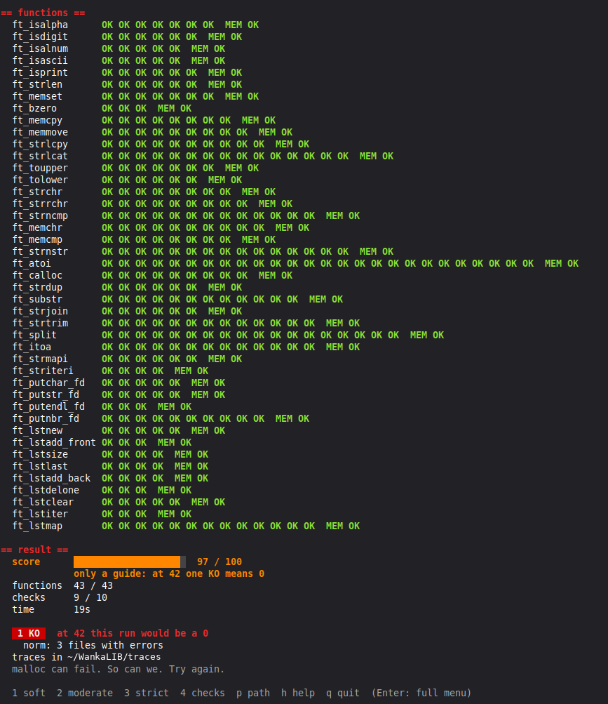

# WankaLIB

LIBFT Tester

A tester for the 42 libft, subject version 19.3 (Nov2026, the three parts are mandatory, there is no bonus)

It checks the functions and also everything around them: files, 42 headers, norm, Makefile, prototypes, forbidden functions and the README

Your libft is never modified. The tester copies it to a hidden folder and builds it there

_42Malaga_

> Versión en español al final: [Español](#español)

## Preview




## Install

```bash
git clone https://github.com/fe4d1/WankaLIB.git
cd WankaLIB
```

Requirements: Linux, `cc`, `make`

`norminette` and `valgrind` are optional. If they are installed the tester uses them

## Usage

```
./run.sh [options] [targets]
```

Options go first. With no target everything is checked

### Examples

| Command | What it does |
|---|---|
| `./run.sh -p ../libft` | everything |
| `./run.sh -p ../libft norm` | one check |
| `./run.sh -p ../libft header make readme` | several checks |
| `./run.sh -p ../libft ft_split` | one function (`split` works too) |
| `./run.sh -p ../libft atoi itoa split` | several functions |
| `./run.sh -p ../libft part3` | one part (`part1` `part2` `part3`) |
| `./run.sh -p ../libft checks` | every check, no function tests |
| `./run.sh -p ../libft funcs` | every function test, no checks |
| `./run.sh -p ../libft norm ft_split` | mixed: a check and a function |
| `./run.sh -n -p ../libft funcs` | every function, fast (no valgrind) |
| `./run.sh -u jdoe -p ../libft header` | headers must belong to login `jdoe` |
| `./run.sh -h` | help |
| `./run.sh clean` | delete the build files and the traces |
| `./run.sh reset` | put the tester back as in its last commit |

### Options

| Option | Meaning |
|---|---|
| `-p path` | where the libft is. Default is `LIBFT` in `config.sh` |
| `-n` | no valgrind: faster, but leaks are not checked |
| `-u login` | the login every 42 header must have. Without it the tester only checks that all files have the same author |
| `-h` | help |

To stop typing `-p`, set `LIBFT` in `config.sh`

### Targets

| Target | Runs |
|---|---|
| none or `all` | everything |
| `checks` | `files header norm make protos symbols readme` |
| `files` `header` `norm` `make` `protos` `symbols` `readme` | that check only |
| `funcs` | the 43 function tests |
| `part1` `part2` `part3` | the function tests of that part |
| `ft_name` or `name` | that function only |

The exit code is 0 when there is no KO

### Clean and reset

| Command | Does |
|---|---|
| `./run.sh clean` | deletes `.build/` `.bin/` and `traces/`. Like `make fclean` |
| `./run.sh reset` | throws away every change made to the tester since the last commit, also new files. It lists the changes and asks you to type `yes` first |

You rarely need `clean`: every run deletes the old traces, and `traces/` disappears when everything passes. None of these folders are tracked by git

`reset` goes back to the last commit, not to the GitHub version. To get exactly the GitHub version run `git fetch && git reset --hard origin/main`

## Checks

| Target | What it looks at |
|---|---|
| `files` | the 43 `.c` files, `Makefile`, `libft.h` and `README.md` exist. Extra files tracked in git. Uncommitted changes |
| `header` | 42 header in every file: 80 columns, right file name, login and mail, same author in all files. The campus in the mail is not checked, so it works for any campus |
| `norm` | norminette on every `.c` and `.h` |
| `make` | rules `$(NAME)` `all` `clean` `fclean` `re` exist and work. `NAME` is `libft.a` and it is created at the root. Compiler is `cc`. The three flags on every file, and every `.c` compiles alone with them. Built with `ar`, no `libtool`. No wildcard. No `-std=c99`. No relink |
| `protos` | include guard, `t_list` has exactly `content` and `next`, every prototype compared with the subject. No `restrict` |
| `symbols` | external functions used by each file against what the subject allows for that function. Global variables, also the `static` and `const` ones. Helpers that are not static. A `main` left inside the library |
| `readme` | first line, the Description Instructions and Resources sections, AI usage, every function mentioned (the detailed description of the library) |

What the subject asks and where it is checked

| Subject | Target |
|---|---|
| Norm | `norm` `header` |
| No crash, no leak | function tests |
| `cc` with `-Wall -Wextra -Werror`, no relink, the five rules | `make` |
| Files to submit, files at the root, no unused files | `files` |
| No global variables, static helpers | `symbols` |
| `ar` and not `libtool`, `libft.a` at the root | `make` |
| Same prototypes as the originals, no `restrict`, no `-std=c99` | `protos` `make` |
| No external functions in part 1, only the listed ones in parts 2 and 3 | `symbols` |
| `is*` functions return exactly 1 or 0 | function tests |
| `calloc` with 0 returns a unique pointer that can be freed | function tests |
| `NULL` when an allocation fails | function tests |
| `t_list` structure | `protos` |
| README requirements | `readme` |

Two things cannot be checked by a script: that the README resources are real references, and that you can explain your code

## Function tests

One file per function in `tests/`. Each one checks

- normal results and edge cases
- crashes and infinite loops
- leaks and invalid reads with valgrind
- every `malloc` failing in turn, to see that the function returns `NULL` and frees what it had

## Output

```
== makefile ==
  OK    compiler is cc
  KO    relink (second make does something)

== functions ==
  ft_strlen       OK OK OK OK OK OK  MEM OK
  ft_itoa         OK OK OK OK OK OK OK OK OK OK KO OK OK  MEM OK  (traces/ft_itoa.txt)
```

| Word | Meaning |
|---|---|
| `OK` | the check or test passed |
| `KO` | it failed. See the file in `traces/` |
| `WARN` | not a fail, but look at it |
| `MEM OK` | valgrind found no leaks and no invalid reads or writes in that function |
| `MEM KO` | valgrind found a problem. The details are in the trace file |
| `CRASH` | the function crashed (segfault, bus error, abort) |
| `TIMEOUT` | the test never finished, usually an infinite loop |

`MEM` does not appear with `-n`

Every KO leaves a file in `traces/`

```
KO test 11 (line 16): int min
   string result
   got      [-]
   expected [-2147483648]
```

The line number is the line in `tests/ft_itoa.c`. Valgrind errors are added to the same file

## Add or change tests

Open `tests/ft_name.c` and add a line

```c
T("empty", ft_strlen("") == 0);                    // any condition
TS("int min", ft_itoa(INT_MIN), "-2147483648");    // string result, frees it
TT("two words", ft_split("a b", ' '), "a", "b");   // split result, frees it
OUT("42", ft_putnbr_fd(42, fd), "42");             // what was written on fd
MFAIL("malloc fails", ft_strdup("abc"), free);     // each malloc fails in turn
```

Other things you can change

- `config.sh` libft path, flags, function lists, allowed external functions per function, README rules
- `utils/protos.c` the expected prototypes

To test a new function add its name to a list in `config.sh` and create `tests/ft_name.c`

## Layout

```
run.sh       runner
config.sh    settings
tests/       one file per function
utils/       check.c check.h (the test macros) and protos.c
traces/      created when something fails, deleted by clean
docs/        screenshots for this README
```

## Notes

- Function tests need GNU ld (`--wrap=malloc`), so Linux only
- `ft_memcpy` and `ft_memmove` are tested with `NULL NULL 3` and expected to return `NULL`, like most 42 testers do
- Passing `NULL` as `del` to the list functions is not tested, the subject does not define it

## License

MIT, see [LICENSE](LICENSE)

## Español

<details>
<summary>Abrir</summary>

Tester para la libft de 42, versión 19.3 (Nov2026, las tres partes son obligatorias, no hay bonus)

Revisa las funciones y todo lo demás: archivos, cabeceras 42, norma, Makefile, prototipos, funciones prohibidas y el README. Tu libft no se modifica: se copia a una carpeta oculta y se compila ahí

_42Malaga_

Las capturas de cómo se ve están arriba, en "Preview"

### Uso

```
./run.sh [opciones] [targets]
```

Las opciones van primero. Sin target se revisa todo

| Comando | Qué hace |
|---|---|
| `./run.sh -p ../libft` | todo |
| `./run.sh -p ../libft norm` | un chequeo |
| `./run.sh -p ../libft header make readme` | varios chequeos |
| `./run.sh -p ../libft ft_split` | una función (`split` también vale) |
| `./run.sh -p ../libft atoi itoa split` | varias funciones |
| `./run.sh -p ../libft part3` | una parte (`part1` `part2` `part3`) |
| `./run.sh -p ../libft checks` | todos los chequeos, sin funciones |
| `./run.sh -p ../libft funcs` | todas las funciones, sin chequeos |
| `./run.sh -p ../libft norm ft_split` | mezclado: un chequeo y una función |
| `./run.sh -n -p ../libft funcs` | todas las funciones, rápido (sin valgrind) |
| `./run.sh -u jdoe -p ../libft header` | las cabeceras deben ser del login `jdoe` |
| `./run.sh -h` | ayuda |
| `./run.sh clean` | borra los archivos de compilación y las trazas |
| `./run.sh reset` | deja el tester como en su último commit |

| Opción | Significa |
|---|---|
| `-p ruta` | dónde está la libft. Por defecto, `LIBFT` en `config.sh` |
| `-n` | sin valgrind: más rápido, pero no revisa fugas |
| `-u login` | el login que deben tener todas las cabeceras. Sin esta opción solo se comprueba que todos los archivos tengan el mismo autor |
| `-h` | ayuda |

Para no escribir `-p` cada vez, cambia `LIBFT` en `config.sh`

### Limpiar y resetear

| Comando | Hace |
|---|---|
| `./run.sh clean` | borra `.build/` `.bin/` y `traces/`. Como `make fclean` |
| `./run.sh reset` | descarta todos los cambios hechos al tester desde el último commit, también los archivos nuevos. Antes muestra la lista y pide escribir `yes` |

Casi nunca hace falta `clean`: cada ejecución borra las trazas anteriores y `traces/` desaparece si todo pasa. Ninguna de estas carpetas se sube a git

`reset` vuelve al último commit, no a la versión de GitHub. Para tener exactamente la de GitHub: `git fetch && git reset --hard origin/main`

### Resultado

| Palabra | Significa |
|---|---|
| `OK` | pasó |
| `KO` | falló. Mira el archivo en `traces/` |
| `WARN` | no es un fallo, pero conviene mirarlo |
| `MEM OK` | valgrind no encontró fugas ni lecturas o escrituras inválidas |
| `MEM KO` | valgrind encontró un problema. El detalle está en la traza |
| `CRASH` | la función crasheó (segfault, bus error, abort) |
| `TIMEOUT` | el test no terminó, casi siempre un bucle infinito |

Cada KO deja un archivo en `traces/` con el número de línea del test, lo que se obtuvo y lo que se esperaba

### Notas

- La cabecera no revisa el campus del correo: sirve para cualquier campus
- Para añadir un test, abre `tests/ft_nombre.c` y añade una línea. Los ejemplos de las macros están arriba, en "Add or change tests"
- Solo funciona en Linux

</details>
